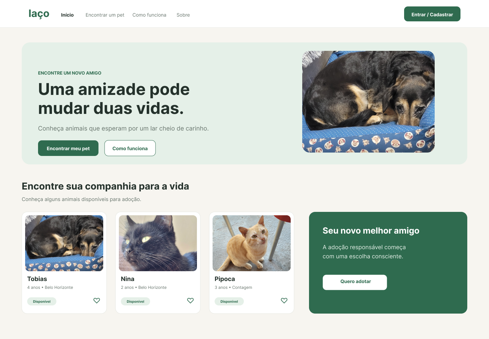
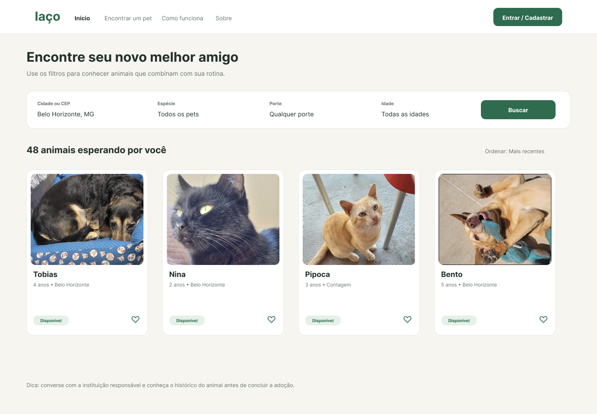
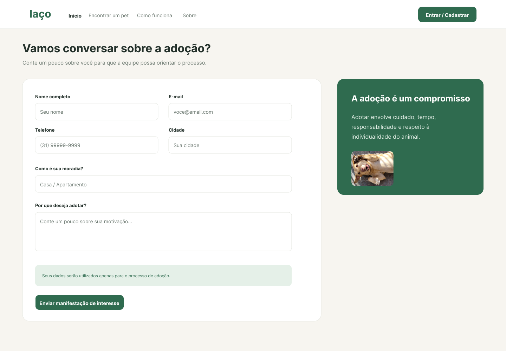

# Laço — Plataforma de Adoção de Animais

Projeto de UI/UX desenvolvido para conceber uma plataforma digital voltada à adoção responsável de animais, priorizando acessibilidade, organização das informações e experiência do usuário.

## Sobre o projeto

O Laço propõe uma experiência digital que aproxima pessoas interessadas em adotar animais de organizações e responsáveis pelo processo de adoção.

A interface foi planejada para tornar a navegação intuitiva, facilitar a consulta aos perfis dos animais e organizar as etapas necessárias para manifestar interesse na adoção.

## Objetivos

- Desenvolver uma interface intuitiva e responsiva.
- Facilitar a busca e a visualização de animais disponíveis para adoção.
- Organizar as informações individuais de cada animal.
- Estruturar um fluxo digital para solicitação de adoção.
- Proporcionar uma experiência consistente entre dispositivos Desktop e Mobile.

## Funcionalidades projetadas

- Página inicial com apresentação da plataforma.
- Busca e visualização dos animais.
- Perfil individual dos animais.
- Página explicativa sobre o processo de adoção.
- Formulário de interesse em adoção.
- Tela de confirmação.
- Menu de navegação adaptado para dispositivos móveis.

## Design e experiência do usuário

O projeto contempla duas versões de interface:

- **Desktop:** organização dos elementos para telas maiores.
- **Mobile:** adaptação dos componentes, navegação e disposição dos conteúdos para dispositivos móveis.

Foi desenvolvido um Design System com definição de cores, tipografia, componentes e padrões visuais.

## Identidade visual

- Verde principal: `#2F6B4F`
- Verde suave: `#E5F0E8`
- Coral: `#E98268`
- Amarelo: `#F2C66D`
- Fundo: `#F7F5F0`
- Tipografia: Inter

## Ferramentas utilizadas

- Figma — design de interface, prototipagem e organização do Design System.
- GitHub — versionamento e documentação do projeto.

## Protótipo interativo

[Visualizar projeto no Figma](https://www.figma.com/proto/5VeRDcs8VFbeAV9z1W82G1/LA%C3%87O-PLATAFORMA-DE-ADO%C3%87%C3%83O-DE-PETS?node-id=0-1&t=RDKoydVE5A390X8L-1)

## Status

Projeto de interface e prototipagem concluído, com telas Desktop e Mobile e fluxos de navegação interativos.

## Telas do projeto

### 1. Versão Desktop

**Página inicial**

**Busca de animais**

**Formulário de adoção**

**Confirmação da adoção**

### 2. Versão Mobile

**Página inicial**

**Busca de animais**

**Perfil do animal**

**Menu de navegação**

**Confirmação**

### 3. Página Como Funciona

Desenvolvido como projeto de portfólio na área de UI/UX Design.
